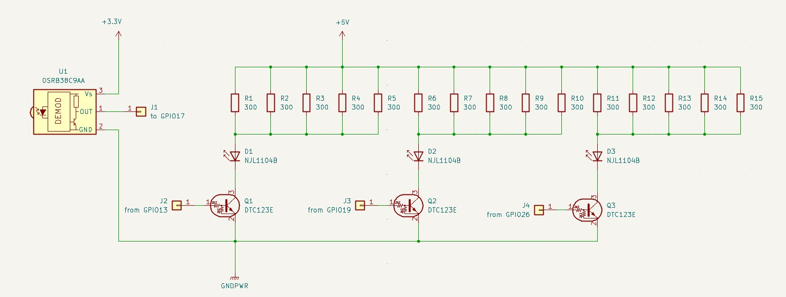

# learning_voice_remocon
## Overview
learning_voice_remoconは音声制御が可能な学習リモコンで、大きく分けて以下の２つのモジュールから構成される。
1. raspberry pi zero 2 w 用の赤外線センサーと赤外線LEDを制御するモジュール
2. スマホ等にインストールして、音声認識と各機器向けのコマンドを制御するモジュール
これら2つのモジュールはWIFIを介して、専用プロトコルで通信を行う。
## Scope
本プロジェクトはraspberry pi zero 2 w上で動作する赤外線センサーと赤外線LEDを制御するモジュールを対象とする。
## Design Outline
本プロジェクトでは、raspberry pi zero 2 w 上にRaspberry Pi OSをインストールし、その上でpigpioを使用して赤外線センサーと赤外線LEDを制御する。
### Preliminary Phase
予備段階として、raspberry pi zero 2 wに外付けする赤外線モジュールのHardware確認の為、  
学習または送信コマンドによって赤外線を受信しファイルへの書き出し、またはファイルから読んだデータを基に  
約38KHzキャリアで変調した赤外線の送信を行うコードを実装した。  
赤外線モジュールは以下の回路図で示す。

Fig. 1 赤外線モジュール回路図  

詳細は、[README](.README.md)を参照のこと。

### First Phase
第一段階では、アプリケーション `learningremote` を対話形式で実行する。
起動後は標準入力から1行ずつコマンドを受け付け、`quit` が入力されるか標準入力が閉じられるまで待ち続ける。
空行は無視し、不正なコマンドや引数が入力された場合はエラーを表示して次の入力を待つ。
#### コマンド概要
1. quit - アプリケーションを終了する
2. learn `<name>` - 赤外線を学習する
3. send `<name>` - 学習した赤外線を送信する
4. delete `<name>` - 指定した学習データを削除する
5. list - 学習した赤外線の一覧を表示する
6. allclear - 学習データをすべて消去する

`quit` 以外のコマンドとオプションはREADME.mdに記載した形式に従う。
データベースの既定ファイルは `codes.db` とする。

```text
learn <name> [--db FILE] [--timeout SEC]
send <name> [--db FILE] [--repeat N] [--gap MS]
delete <name> [--db FILE]
list [--db FILE]
allclear [--db FILE]
quit
```

`--timeout` の範囲は1〜600秒、`--repeat` は1〜20回、`--gap` は20〜2000ミリ秒とする。

#### 詳細設計
##### クラス構成
アプリケーション名は `learningremote` とする。`src/learningremote.cpp` に引数を取らない `main` 関数を置く。
`main` はコマンド待ちのループを生成し、入力行の分割、コマンド名と引数の解析、引数の検証、およびコマンドの振り分けを行う。
`quit` の判定とアプリケーションの終了も `main` の責務とする。

1. IRController クラス  
`IRController` クラスは赤外線制御と学習データの操作を行う。コマンド文字列やオプションを解析せず、`main` から渡された値を使って次の処理を実行する。
   - `learn(name, dbPath, timeoutSec)` - 指定 GPIO から赤外線信号を受信し、データベースに保存する。
   - `send(name, dbPath, repeat, gapMs)` - データベースから信号を読み、指定回数と間隔で送信する。
   - `deleteSignal(name, dbPath)` - データベースから指定名の信号を削除する。C++ の予約語 `delete` をメソッド名には使わない。
   - `list(dbPath)` - 登録済み信号の一覧を表示する。
   - `clearAll(dbPath)` - 指定データベース内の学習データをすべて消去する。

GPIO の初期化・終了、pigpio による受信・送信は `IRController` が担当する。SIGINT の処理も同クラスが提供する。

2. IRFileAccessor クラス  
`IRFileAccessor` クラスはSQLiteデータベースファイルの読み書きを行う。SQLiteはアプリケーション内で動作し、`IRController` がこのクラスを介してアクセスする。
   - `open(dbPath)` - データベースファイルを開く。
   - `close()` - データベースファイルを閉じる。
   - `insert(name, data, repeat, gapMs)` - 信号をデータベースに挿入する。
   - `deleteByName(name)` - データベースから指定名の信号を削除する。
   - `update(name, data, repeat, gapMs)` - データベース内の指定名の信号を更新する。
   - `fetchByName(name)` - データベースから指定名の信号を取得する。
   - `fetchAll()` - 登録済み信号をすべて取得する。
   - `clearAll()` - 登録済み信号をすべて消去する。
   - `begin()` - トランザクションを開始する。`open()` の中で開始する。
   - `commit()` - トランザクションをコミットする。
   - `rollback()` - トランザクションをロールバックする。

3. データベース
データベースはSQLiteを使い、既定のファイル名は `codes.db` とする。従来のテキスト形式の `codes.txt` が存在する場合は、内容を `codes.db` に移行して元ファイルを `codes.txt.legacy` に退避する。
データベースのカラムは、以下の様に定義する。
  - `id (INTEGER)` - 信号のIDで `AUTOINCREMENT` する。
  - `name (TEXT)` - 信号の名前。一意とする。
  - `data (TEXT)` - マーク・スペース時間列をカンマ区切りで保持する。
  - `repeat (INTEGER)` - 送信時の繰り返し回数。
  - `gapMs (INTEGER)` - 送信間のギャップ時間（ミリ秒）。
